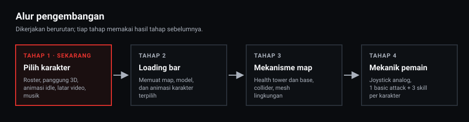
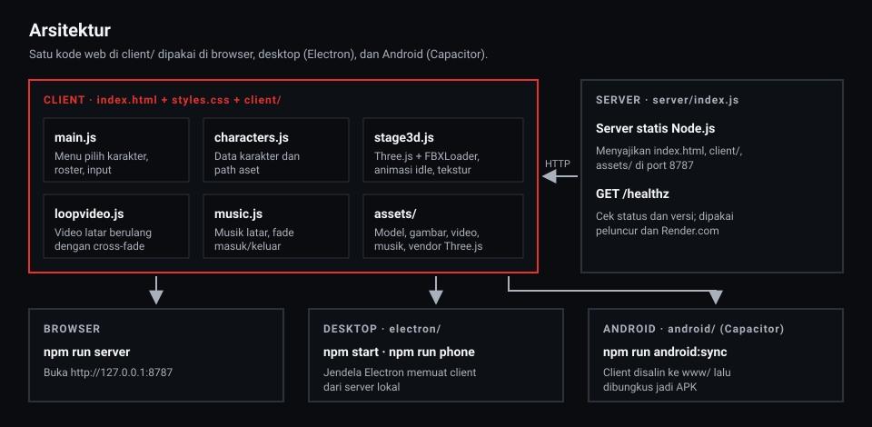
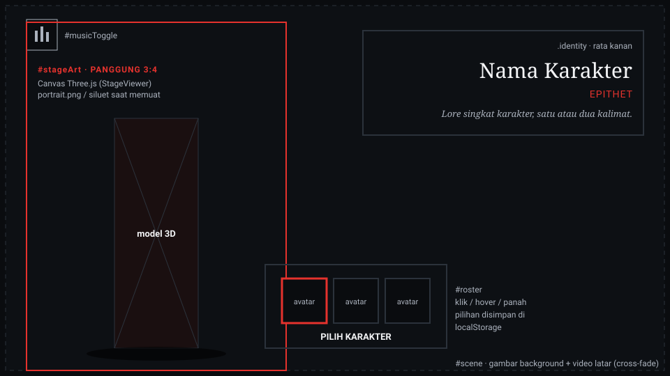
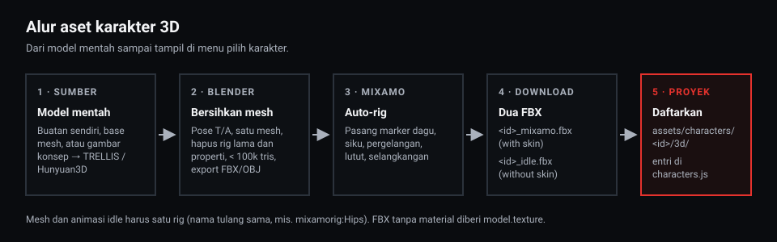

# Logicodix

Game aksi bertema Nusantara dengan tokoh dari sejarah dan cerita rakyat Indonesia. Game berjalan
di browser, desktop (Electron), dan Android (Capacitor) dari satu kode web yang sama.

Proyek ini sedang dibangun ulang dari awal. Versi sebelumnya (MOBA fisika 3v3, "Momentum
Arena") masih ada di riwayat git, commit `970afd2`. Arah produk ada di [PRD.md](./PRD.md);
dokumen itu masih menggambarkan versi lama dan akan disesuaikan seiring pembangunan ulang.

## Daftar isi

- [Status](#status)
- [Alur pengembangan](#alur-pengembangan)
- [Menjalankan](#menjalankan)
- [Arsitektur](#arsitektur)
- [Layar pilih karakter](#layar-pilih-karakter)
- [Struktur folder](#struktur-folder)
- [Data karakter](#data-karakter)
- [Menambah karakter](#menambah-karakter)
- [Android dan CI](#android-dan-ci)
- [Deploy](#deploy)
- [Variabel lingkungan](#variabel-lingkungan)
- [Aset dan lisensi](#aset-dan-lisensi)

## Status

**Tahap 1: menu pilih karakter.** Roster tiga karakter, panggung 3D dengan animasi idle, latar
gambar dan video per karakter, serta musik latar.

| Karakter | Model 3D | Animasi idle | Avatar | Portrait | Latar (gambar / video) |
|---|---|---|---|---|---|
| Gadjah Mada | ✅ | ✅ | ✅ | ✅ | ✅ / ✅ |
| Nyi Roro Kidul | ✅ | ✅ | ✅ | ⬜ | ✅ / ✅ |
| Leak | ✅ | ✅ | ✅ | ⬜ | ✅ / ✅ |

Kolom yang belum terisi tetap aman: menu menampilkan siluet sebagai pengganti avatar atau
portrait, dan latar gelap bawaan bila karakter belum punya latar.

## Alur pengembangan



| Tahap | Cakupan |
|---|---|
| 1. Pilih karakter | Roster, panggung 3D, animasi idle, latar video, musik. **Sedang dikerjakan.** |
| 2. Loading bar | Memuat map, model, dan animasi karakter yang dipilih sebelum masuk permainan. |
| 3. Mekanisme map | Health tower dan base, collider, mesh lingkungan. |
| 4. Mekanik pemain | Kontrol joystick analog; tiap karakter punya 1 basic attack dan 3 skill yang berbeda. |

## Menjalankan

Prasyarat: **Node.js 20** atau lebih baru. Untuk build Android juga butuh JDK 21 dan Android SDK.

```bash
npm install
npm run check    # pemeriksaan sintaks dan aset
npm start        # server lokal + jendela Electron
```

| Perintah | Fungsi |
|---|---|
| `npm run server` | Server statis saja, buka `http://127.0.0.1:8787` di browser. |
| `npm start` | Menyalakan server (atau memakai yang sudah berjalan bila versinya sama) lalu membuka jendela Electron. |
| `npm run phone` | Seperti `npm start`, tetapi jendela berukuran ponsel landscape (915×412). F2 memutar layar, F3 mengganti ukuran. |
| `npm run online` | Menyalakan server dan membuat link publik sementara lewat Cloudflare Tunnel (`*.trycloudflare.com`). `cloudflared` diunduh otomatis ke `tools/` saat pertama dipakai. |
| `npm run check` | Memeriksa sintaks semua file JS dan memastikan setiap aset yang dirujuk `client/characters.js` benar-benar ada. |
| `npm run build:www` | Menyalin client ke `www/` untuk dibungkus Capacitor. |
| `npm run android:sync` | `build:www` lalu `cap sync android`. |
| `npm run android:open` | Membuka proyek Android di Android Studio. |
| `npm run android:apk` | Build APK debug secara lokal. |

## Arsitektur



- **Client** (`index.html`, `styles.css`, `client/`) adalah ES module murni tanpa bundler. Three.js
  dan FBXLoader disimpan di `assets/vendor/` dengan import relatif, jadi tidak ada langkah build
  untuk web.
- **Server** (`server/index.js`) hanya menyajikan file statis dari daftar putih (`index.html`,
  `styles.css`, `manifest.webmanifest`, `sw.js`, `client/`, `assets/`) dan menyediakan
  `GET /healthz` yang mengembalikan status dan versi dari `package.json`.
- **Electron** (`electron/`) hanya untuk desktop (Windows, macOS, Linux). Jendelanya memuat
  client dari server lokal.
- **Android** memakai **Capacitor** (`android/`, `capacitor.config.json`), bukan Electron.
  `scripts/build-www.mjs` menyalin client ke `www/` dan menandai `<body data-native="1">`; isi
  `www/` lalu dibungkus menjadi APK. Karena itu semua fitur, termasuk kontrol sentuh dan joystick
  nanti, harus berjalan di WebView biasa tanpa API khusus Electron.

## Layar pilih karakter



| Bagian | Elemen | Keterangan |
|---|---|---|
| Latar | `#scene` | Gambar `background` tampil lebih dulu, lalu video `backgroundVideo` diputar bisu dan diulang dengan cross-fade 1,5 detik (`client/loopvideo.js`). |
| Panggung | `#stageArt` | Rasio 3:4 di kiri. `portrait.png` atau siluet tampil selama model dimuat, lalu canvas Three.js (`StageViewer` di `client/stage3d.js`) menggantikannya. Kamera menyesuaikan diri agar seluruh badan pas. |
| Identitas | `.identity` | Nama, epithet, dan lore karakter, rata kanan. |
| Roster | `#roster` | Tile avatar. Pilih dengan klik atau ketuk, pratinjau dengan hover mouse, pindah dengan tombol panah. Pilihan terakhir disimpan di `localStorage` (`logicodix.character`). |
| Musik | `#musicToggle` | Menyalakan atau mematikan musik latar (`client/music.js`). Musik mulai pada interaksi pertama karena browser memblokir suara otomatis. |
| Efek suara | `client/sfx.js` | Bunyi hover saat karakter yang tampil berganti karena aksi pemain: hover mouse ke tile lain, ketuk atau Enter pada tile lain, dan tombol panah. Ikut dibisukan oleh `#musicToggle`. |

Perilaku cadangan:

- Semua model dimuat di latar belakang setelah menu tampil, jadi berpindah karakter terasa instan.
- Bila WebGL tidak tersedia, panggung tetap memakai `portrait.png` (atau siluet).
- Bila `prefers-reduced-motion` aktif atau browser tidak mendukung WebM VP9, video latar tidak
  diputar dan gambar `background` yang dipakai. Animasi idle juga berhenti saat reduced motion aktif.

## Struktur folder

| Folder / berkas | Isi |
|---|---|
| `client/main.js` | Logika menu: roster, pilihan, latar, panggung. |
| `client/characters.js` | Daftar karakter dan path asetnya. |
| `client/stage3d.js` | `StageViewer`: scene Three.js, pemuatan FBX, animasi idle, tekstur, framing kamera. |
| `client/loopvideo.js` | Video latar berulang tanpa lompatan. |
| `client/music.js` | Musik latar dengan fade masuk dan keluar (Web Audio). |
| `client/sfx.js` | `UiSound`: efek suara antarmuka pendek (Web Audio, didekode sekali, dibatasi agar tidak menumpuk). |
| `server/` | Server statis dan `/healthz`. |
| `assets/characters/<id>/` | Model, tekstur, avatar, dan portrait per karakter. Lihat [README aset](assets/characters/README.md). |
| `assets/background-characters/<id>/` | Gambar dan video latar per karakter. |
| `assets/musics/background/` | Musik latar menu. |
| `assets/menu-assets/sounds/` | Efek suara menu (`hover_character_selection.mp3`). |
| `assets/vendor/` | Three.js, FBXLoader, dan dependensinya (`addons/`). |
| `electron/` | Cangkang desktop. |
| `android/` | Proyek Android (Capacitor). |
| `scripts/` | Peluncur (`start`, `online`), pemeriksaan (`check`), dan build (`build-www`). |
| `docs/images/` | Diagram untuk README ini. |

## Data karakter

Setiap karakter adalah satu objek di `client/characters.js`. Folder asetnya memakai nama yang
sama dengan `id`.

| Field | Wajib | Keterangan |
|---|---|---|
| `id` | ya | Nama folder di `assets/characters/` dan `assets/background-characters/`. |
| `name`, `epithet`, `lore` | ya | Teks identitas di kanan atas. |
| `avatar` | tidak | PNG 512×512 (kepala dan bahu) untuk tile roster. `null` berarti siluet. |
| `portrait` | tidak | PNG 900×1200 latar transparan, placeholder selama model dimuat. Harus dirender dari frame pertama animasi idle dengan kamera `StageViewer` supaya peralihan tidak meloncat. |
| `background` | tidak | Gambar latar (WebP), juga cadangan untuk video. |
| `backgroundVideo` | tidak | Video latar WebM VP9, disarankan 1280×720. |
| `model.mesh` | bila ada model | FBX berisi mesh yang sudah di-rig. |
| `model.idle` | bila ada model | FBX animasi idle. **Harus satu rig dengan `mesh`** (nama tulang sama). |
| `model.texture` | tidak | Tekstur warna untuk FBX yang tidak membawa material, misalnya hasil rig Mixamo dari OBJ. Material diganti `MeshStandardMaterial` dua sisi. |
| `model.materials` | tidak | Tekstur PBR per nama material FBX: `{ NamaMaterial: { map, normal, roughness, metalness, ao, alpha, color } }`. Mesh tanpa material bernama `__DEFAULT`. Peta `alpha` memakai `alphaTest` (rambut, hiasan berlubang). |
| `model.frame` | tidak | Framing kamera untuk model yang bukan badan penuh: `fill` (bagian tinggi panggung yang diisi, bawaan 1) dan `anchor` (posisi tengah model dari bawah, bawaan 0,5). Leak memakai `{ fill: 0.6, anchor: 0.62 }`. |

Contoh:

```js
{
  id: "nyi-roro-kidul",
  name: "Nyi Roro Kidul",
  epithet: "Ratu Laut Selatan",
  lore: "Ratu gaib yang bersemayam di Laut Selatan dalam kisah Jawa, penguasa ombak dan pantai selatan.",
  avatar: `${dir("nyi-roro-kidul")}/avatar.png`,
  portrait: null,
  background: `${bgDir("nyi-roro-kidul")}/pelataran.webp`,
  backgroundVideo: `${bgDir("nyi-roro-kidul")}/pelataran.webm`,
  model: {
    mesh: `${dir("nyi-roro-kidul")}/3d/kadita_mixamo.fbx`,
    idle: `${dir("nyi-roro-kidul")}/3d/kadita_idle.fbx`,
    texture: `${dir("nyi-roro-kidul")}/texture/kadita_high.png`,
  },
}
```

## Menambah karakter



1. **Siapkan model.** Buat sendiri, pakai base mesh berlisensi jelas, atau ubah gambar konsep
   menjadi 3D dengan TRELLIS.2 atau Hunyuan3D (gratis di Hugging Face).
2. **Bersihkan di Blender.** Pose T atau A, gabungkan jadi satu mesh, hapus armature lama, buang
   properti yang terpisah (senjata, efek), apply transform, dan jaga di bawah sekitar 100 ribu
   segitiga. Export FBX atau OBJ (untuk OBJ, zip bersama MTL dan teksturnya).
3. **Rig di Mixamo.** Upload, pasang marker dagu, siku, pergelangan tangan, lutut, dan
   selangkangan. Pilih Skeleton LOD *No Fingers* bila jari model kecil atau menempel.
4. **Download dua FBX:** mesh dengan skin (`<id>_mixamo.fbx`) dan animasi idle tanpa skin
   (`<id>_idle.fbx`). Keduanya otomatis memakai rig yang sama (`mixamorig:*`).
5. **Daftarkan di proyek.** Taruh FBX di `assets/characters/<id>/3d/`, lalu isi entri di
   `client/characters.js`. Tambahkan `avatar`, `background`, dan aset lain bila sudah ada.
6. **Periksa** dengan `npm run check`, lalu jalankan `npm start`.

Karakter yang bukan humanoid (misalnya Leak, kepala bertopeng yang melayang) tidak perlu Mixamo:
skeleton bawaan model dipakai langsung, dengan `<id>_static.fbx` sebagai mesh di pose dasar dan
`<id>_idle.fbx` berisi animasi idle pada rig yang sama.

Penyebab umum auto-rig Mixamo gagal:

- FBX masih membawa skeleton atau animasi lama. Mixamo mencoba memakai rig itu dan tidak
  menjalankan auto-rig.
- Ada objek lain di file (senjata, efek, lantai), atau mesh terpecah menjadi banyak bagian terpisah.
- Kaki tidak terpisah (misalnya rok atau ekor yang menyatu). Auto-rig butuh dua kaki yang jelas.
- Ukuran file di atas sekitar 50 MB atau polycount terlalu tinggi.

## Android dan CI

Workflow [`.github/workflows/android.yml`](.github/workflows/android.yml) berjalan pada setiap
push ke `main` (atau manual lewat *workflow_dispatch*): menyiapkan Node 22, JDK 21, dan Android
SDK 36, menjalankan `npm run android:sync`, lalu `gradlew assembleDebug`. APK debug diunggah
sebagai artifact `fisikAsik-apk`.

Variabel repositori `LOGICODIX_DEFAULT_SERVER` (opsional) disisipkan ke `www/index.html` sebagai
alamat server bawaan aplikasi native.

## Deploy

[`render.yaml`](render.yaml) mendefinisikan web service Node di Render.com (paket gratis):
`npm ci --omit=dev`, lalu `npm run server`, dengan health check di `/healthz` dan auto-deploy
dari repo.

## Variabel lingkungan

| Variabel | Dipakai oleh | Fungsi |
|---|---|---|
| `PORT` | server, peluncur | Port server (bawaan `8787`). |
| `LOGICODIX_CLIENT_URL` | Electron | URL client yang dimuat jendela (bawaan `http://127.0.0.1:8787`). |
| `LOGICODIX_SERVER_URL` | peluncur, Electron | Alamat server game yang diteruskan ke client lewat `?server=`. |
| `LOGICODIX_PHONE` | Electron | `1` untuk jendela berukuran ponsel (diatur otomatis oleh `npm run phone`). |
| `LOGICODIX_DEFAULT_SERVER` | `build:www` | Alamat server bawaan untuk build Android. |

## Aset dan lisensi

Sumber dan lisensi setiap aset dicatat di [CREDITS.md](./CREDITS.md). Aset pihak ketiga hanya
boleh masuk repo bila lisensinya jelas (CC0 atau setara, atau CC-BY dengan atribusi).

> [!WARNING]
> Model dan tekstur Nyi Roro Kidul di `assets/characters/nyi-roro-kidul/` saat ini adalah aset
> sementara yang diturunkan dari hero Kadita di *Mobile Legends: Bang Bang* (hak cipta Moonton).
> Aset ini hanya untuk prototipe lokal dan harus diganti dengan model orisinal sebelum game
> dirilis atau ditampilkan ke publik.

Kode pihak ketiga: [Three.js](https://threejs.org/) dan addon-nya (MIT), lihat
`assets/vendor/three.LICENSE`.
